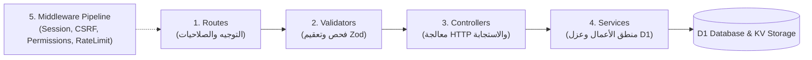

# نظام وقواعد هندسة الواجهة الخلفية لمنظومة MobiDash
# MobiDash Backend Architecture & Engineering Guidelines

> [!WARNING]
> **أرشيف الجيل السابق — لا يُعتمد في كود جديد.**
> المرجع المعتمد: [`engineering/UNIFIED_METHODOLOGY.md`](./engineering/UNIFIED_METHODOLOGY.md) · [`project/PROJECT_PROFILE.md`](./project/PROJECT_PROFILE.md).
> أمثلة الكود هنا قد لا تطابق الكود الحالي؛ لا تنسخ منها بلا مطابقة.

> **الغرض من هذا الملف:**
> هذا الدليل هو المرجع البرمجي والهندسي الإلزامي والمستمر لكافة أكواد الواجهة الخلفية (Backend) في مشروع MobiDash المبني على Cloudflare Workers و Hono Framework وقاعدة بيانات D1 وذاكرة KV.
> يُلزم الذكاء الاصطناعي (AI Agent) والمهندسين باتباع هذه الأنماط بدقة تامة لمنع أي ثغرات أمنية، تسريب بيانات بين المتاجر، أو كسر لمعايير الاستجابة والصلاحيات.

> [!IMPORTANT]
> **الترابط الأمني والبياني واللغوي الإلزامي:**
> 1. يجب مراجعة والالتزام التام بالقواعد الأمنية وقائمة الممنوعات الفورية الموثقة في ملف [SECURITY_AND_BEST_PRACTICES.md](./SECURITY_AND_BEST_PRACTICES.md) (حظر البيانات الوهمية، حظر Any، حظر تسريب الـ Isolate).
> 2. يجب الالتزام الصارم بالقواعد الهندسية لكتابة استعلامات D1 والمعاملات الذرية `db.batch()` ودستور الفهرسة الموثقة في [DATABASE_QUERIES_AND_INDEXING.md](./DATABASE_QUERIES_AND_INDEXING.md).
> 3. يجب الالتزام بالقواعد اللغوية لمفاهيم TypeScript النظيفة والحراس ومكافحة أخطاء الذكاء الاصطناعي الموثقة في [TYPESCRIPT_CONCEPTS.md](./TYPESCRIPT_CONCEPTS.md).
> 4. يجب الالتزام بأدلة الاستخدام المعتمدة لمكتبات وحزم المشروع الموثقة في مجلد [libraries/](./libraries/) وخاصة [HONO.md](./libraries/HONO.md)، [HONO_ZOD_VALIDATOR.md](./libraries/HONO_ZOD_VALIDATOR.md)، [ZOD.md](./libraries/ZOD.md)، [SANITIZATION.md](./libraries/SANITIZATION.md)، [CLOUDFLARE_SDK.md](./libraries/CLOUDFLARE_SDK.md)، و [WRANGLER_AND_VITEST.md](./libraries/WRANGLER_AND_VITEST.md).
> يُمنع منعاً باتاً كتابة أي بيانات وهمية (Mock Data) أو افتراض قيم ثابتة في الجلسات أو الصلاحيات، ويجب ربط كافة البيانات ديناميكياً بقاعدة البيانات وسياق الطلب الحقيقي.

---

## 1. قيود تشغيلية وتوجيهات توفير التوكنات (Token-Saving & Operational Constraints)

1. **الاعتماد الكلي على هذا الدليل:**
   - لا تبحث عشوائياً داخل ملفات الخدمات أو المسارات القديمة؛ كافة القواعد والهياكل والأنماط موثقة بالكامل في هذا الملف.
2. **أمر التحقق الوحيد المعتمد:**
   - للتحقق من سلامة الأكواد وخلوها من الأخطاء البرمجية بعد أي تعديل، استخدم **حصراً** أمر فحص الأنواع الصامت والسريع:
     ```powershell
     cd F:\program\MobiDash\backend; npx tsc --noEmit
     ```
3. **حظر أوامر Git و GitHub وأوامر البناء الثقيلة:**
   - **يُمنع منعاً باتاً** تشغيل أي أمر رفع (`git push`، `git commit`، `gh ...`) أو أوامر نشر ثقيلة (`wrangler deploy`، `npm run deploy`) دون طلب وتوجيه كتابي صريح ومباشر من المستخدم.
4. **التعديلات اليدوية الجراحية الدقيقة (Surgical In-Place Edits):**
   - تُجرى التعديلات مباشرة على الأسطر المعنية داخل الملف الأصلي بدقة.
   - يُمنع إنشاء سكربتات لتوليد أو تطبيق التعديلات بدلاً من التعديل اليدوي المباشر.
   - في التعديلات الهيكلية الكبيرة: **استئذان مسبق إلزامي** وشرح الخطة قبل البدء.

---

## 2. معمارية الطبقات الخمس المعتمدة (5-Layer Architecture)

تعتمد الواجهة الخلفية فصلاً هندسياً صارماً بين المسؤوليات (Separation of Concerns) عبر خمس طبقات محددة:



---

### الطبقة الأولى: المسارات (Routes Layer - `src/routes/`)

- **المسار:** `src/routes/[feature].routes.ts`
- **المسؤولية:** تعريف نقاط النهاية (Endpoints)، ربط حماية الصلاحيات (`requirePermission`)، وربط مدققات Zod (`zValidator`).
- **القواعد الصارمة:**
  1. يُمنع منعاً باتاً كتابة أي منطق أعمال (Business Logic) أو استعلامات SQL داخل ملفات المسارات؛ المسار يربط الطلب بدالة الـ Controller فقط.
  2. استخدام كائن موجه Hono مع تمرير السياق الموحد: `const router = new Hono<AppContext>()`.
  3. حظر استقبال أي بيانات (Body أو Query) دون فحصها عبر `@hono/zod-validator`.
  4. في حال فشل التحقق، يجب إرجاع خطأ 400 موحد عبر `sendResponse`:
     ```ts
     zValidator('json', createSchema, (result, c) => {
       if (!result.success) {
         return sendResponse(c, 400, 'VALIDATION_ERROR', 'البيانات المدخلة غير صالحة', null, result.error.issues);
       }
     })
     ```
  5. ربط الصلاحيات المطلوبة للمسار إما على مستوى الموجه بالكامل أو المسار الفردي:
     ```ts
     router.use('*', requirePermission(['inventory', 'pos']));
     ```

---

### الطبقة الثانية: فحص وتعقيم المدخلات (Validators Layer - `src/validators/`)

- **المسار:** `src/validators/[feature].validators.ts`
- **المسؤولية:** بناء مخططات التحقق الصارمة باستخدام مكتبة `zod` وتطهير المدخلات قبل وصولها لقاعدة البيانات.
- **القواعد الصارمة:**
  1. **التعقيم الإلزامي لكافة النصوص المخزنة (`sanitizeForDb`):**
     لحماية قاعدة البيانات والمتجر من هجمات XSS وحقن الوسوم، يجب تطبيق `.transform(sanitizeForDb)` على كل حقل نصي يُخزن في قاعدة البيانات:
     ```ts
     import { z } from 'zod';
     import { sanitizeForDb } from '../utils/sanitize';

     export const createItemSchema = z.object({
       name: z.string().trim().min(2, { message: 'name_too_short' }).max(100).transform(sanitizeForDb),
       barcode: z.string().trim().min(3).max(50).optional().nullable(),
       price: z.number().min(0, { message: 'invalid_price' }),
       cost_price: z.number().min(0).optional().default(0),
       quantity: z.number().int().min(0).default(0),
       notes: z.string().trim().max(500).optional().nullable().transform(val => val ? sanitizeForDb(val) : val),
     });
     ```
  2. **استخدام التصفح الموحد:**
     استيراد `paginationSchema` من `src/validators/pagination.validators.ts` لأي مسار يدعم البحث والترقيم.
  3. **تصدير الأنواع البرمجية (Inferred Types):**
     تصدير نوع TypeScript المقابل لكل مخطط لاستخدامه في الـ Services:
     ```ts
     export type CreateItemInput = z.infer<typeof createItemSchema>;
     ```

---

### الطبقة الثالثة: وحدات التحكم (Controllers Layer - `src/controllers/`)

- **المسار:** `src/controllers/[feature].controller.ts`
- **المسؤولية:** طبقة النقل الشبكي (HTTP Transport Layer)؛ استخراج المدخلات من سياق الطلب، استدعاء الخدمة، وإرجاع الاستجابة القياسية عبر `sendResponse`.
- **القواعد الصارمة:**
  1. **يُمنع كتابة استعلامات SQL داخل الـ Controller نهائياً.**
  2. استخراج الموارد المطلوبة من سياق Hono:
     - قاعدة البيانات: `const db = c.env.DB;`
     - المستخدم المصادق: `const user = c.get('user')!;`
     - البيانات المفحوصة: `const body = c.req.valid('json' as never) as any;`
     - المعاملات: `c.req.param('id')` و `c.req.query('search')`.
     - ذاكرة KV: `const kv = c.env.K1 || (c.env as any).ouradash_dashboard;`
  3. استدعاء الخدمة المناسبة وفحص الأخطاء المنطقية العائدة منها:
     ```ts
     const result = await ItemService.create(db, body, user);
     if ('error' in result && result.error) {
       return sendResponse(c, result.status as any, result.error, result.message);
     }
     return sendResponse(c, 201, 'ITEM_CREATED', 'تم إنشاء العنصر بنجاح', result);
     ```
  4. تغليف كل دالة داخل `try / catch` مع تسجيل الخطأ عبر `logger.error` وإعادة استجابة 500 موحدة:
     ```ts
     catch (error: any) {
       logger.error(c.get('requestId') || 'unknown', 'Failed to execute operation', error);
       return sendResponse(c, 500, 'INTERNAL_SERVER_ERROR', 'حدث خطأ داخلي أثناء تنفيذ العملية', null, error.message);
     }
     ```

---

### الطبقة الرابعة: الخدمات وقاعدة البيانات (Services Layer - `src/services/`)

- **المسار:** `src/services/[feature].services.ts`
- **المسؤولية:** منطق الأعمال، الحسابات المالية، التفاعل مع قاعدة بيانات Cloudflare D1، وإدارة الكاش في KV.
- **القواعد الأمنية والهندسية الصارمة:**
  1. **عزل المستأجر الصارم (Strict Multi-Tenant Isolation):**
     - **قاعدة حديدية لا تقبل الاستثناء:** يُمنع منعاً باتاً استعلام أي جدول مشترك بدون تقييد صريح بـ `dashboard_id = currentUser.dashboard_id`.
     - يضمن هذا عدم قدرة أي متجر أو كاشير على رؤية، تعديل، أو حذف بيانات متجر آخر تحت أي ظرف.
  2. **حظر دمج النصوص في الاستعلامات (SQL Injection Defense):**
     - استخدم حصراً الاستعلامات المجهزة المربوطة `db.prepare(...).bind(...)`.
     - يُمنع صراحة استخدام الاستيفاء النصي مثل: ``db.prepare(`SELECT * FROM Items WHERE id = ${id}`)``!
  3. **تأمين البحث بالكلمات المفتاحية (LIKE Wildcard Escaping):**
     - عند البحث بـ `LIKE %...%`، يجب تنظيف وتأمين النص باستخدام `escapeLikePattern`:
     ```ts
     import { escapeLikePattern } from '../utils/sanitize';

     if (search && search.trim()) {
       filterClauses.push(`(p.name LIKE ? ESCAPE '\\' OR p.barcode LIKE ? ESCAPE '\\')`);
       const pattern = `%${escapeLikePattern(search.trim())}%`;
       params.push(pattern, pattern);
     }
     ```
  4. **التصفح الموحد (Standardized Pagination):**
     - استخدام دالة `getPaginationOptions(page, limit, 25)` مع `paginateQuery`:
     ```ts
     const paginationOptions = getPaginationOptions(page, limit, 25);
     const paginatedData = await paginateQuery(db, query, countQuery, params, paginationOptions);
     ```
  5. **عقود الإرجاع الموحدة (Return Contracts):**
     - في حالة النجاح: إرجاع البيانات أو الكائن مباشرة `{ item }` أو `{ items, pagination }`.
     - في حالة الخطأ المنطقي (عدم وجود السجل، رصيد غير كافٍ، تكرار باركود):
       إرجاع كائن خطأ منضبط:
       ```ts
       return { error: 'ITEM_NOT_FOUND', message: 'العنصر المطلوب غير موجود', status: 404 };
       ```
  6. **حماية حساب صاحب المحل (Strict Owner Protection Rule):**
     - يُمنع منعاً باتاً تعديل، حذف، أو حظر الحساب ذي الدور `role === 'owner'`.
  7. **إلغاء الجلسات الفوري (Instant Session Revocation):**
     - عند حظر مستخدم أو إيقافه أو تغيير كلمة مروره، يجب فوراً حذف جلساته النشطة من ذاكرة KV:
       ```ts
       await kv.delete(`session:${sessionId}`);
       ```

---

### الطبقة الخامسة: الوسائط والصلاحيات (Middleware & Security Pipeline)

#### أ. التحقق من الجلسات والورديات (`sessionMiddleware`)
- يتم استخراج التوكن إما من الكوكيز `session_id` أو من هيدر `Authorization: Bearer session:...`.
- يتم جلب الجلسة من KV والتحقق الفوري من:
  - عدم حظر المتجر (`is_banned === 1`).
  - عدم حظر الموظف النشط في الوردية.
  - عدم انتهاء صلاحية الجلسة (`expires_at > now`).
- يتم حقن كائن المستخدم المعتمد في `c.set('user', UserSession)`.
- في حال وجود وردية نشطة، يتم حقنها في `c.set('active_worker', ActiveShiftWorker)`.

#### ب. نظام فحص الصلاحيات الموحد (`requirePermission`)
- **تجاوز المالك والمدير العام (Superuser Bypass):**
  المستخدمون ذوو الدور `role === 'owner'` أو `role === 'admin'` يتجاوزون كافة فحوصات الصلاحيات تلقائياً.
- **فحص الصلاحيات الدقيقة (Granular JSON Permissions):**
  تُخزن صلاحيات الموظف في عمود `permissions` كـ JSON (أو كائن)، وتُفحص باستخدام المسار المنقط (Dot Notation):
  - مثل: `'staff'`, `'inventory.create'`, `'finances.view'`.
- **أوضاع الفحص:**
  - `mode: 'OR'` (الافتراضي): يكفي امتلاك صلاحية واحدة من المصفوفة.
  - `mode: 'AND'`: يشترط امتلاك كافة الصلاحيات المحددة في المصفوفة.
- **حماية تلوث النموذج الأولي (Anti-Prototype Pollution):**
  الميدلوير محمي ومُحصن تلقائياً ضد مسارات التلاعب مثل `__proto__` أو `constructor`.

#### ج. حماية العمليات المالية ونقاط البيع (`requireActiveShift`)
- أي عملية مالية (بيع، استلام نقدية، سحب، إيداع) يجب أن يسبقها التحقق من فتح وردية كاشير نشطة عبر `requireActiveShift`.

---

## 3. معيار الاستجابة الموحدة للواجهة الخلفية (`sendResponse`)

جميع مسارات النظام تُرجع استجابة JSON موحدة البنية عبر الدالة المعتمدة `src/utils/response.ts`:

### في حالة النجاح (200 - 299):
```json
{
  "success": true,
  "code": 200,
  "slug": "RESOURCE_FETCHED",
  "message": "تم جلب البيانات بنجاح",
  "data": { ... },
  "meta": {
    "requestId": "req-xyz-123",
    "timestamp": "2026-10-29T08:00:00.000Z"
  }
}
```

### في حالة أخطاء التحقق من البيانات (400 Bad Request):
```json
{
  "success": false,
  "code": 400,
  "slug": "VALIDATION_ERROR",
  "message": "البيانات المدخلة غير صالحة",
  "data": null,
  "details": [
    { "field": "name", "issue": "name_too_short" },
    { "field": "price", "issue": "invalid_price" }
  ],
  "meta": {
    "requestId": "req-xyz-123",
    "timestamp": "2026-10-29T08:00:00.000Z"
  }
}
```

### في حالة الأخطاء الداخلية (500 Server Error):
- في بيئة التطوير المحلية (Development): تُعرض تفاصيل الخطأ و `stack trace` داخل حقل `debug`.
- في بيئة الإنتاج (Production): يتم حجب تفاصيل الـ Stack تلقائياً لمنع تسريب أسرار السيرفر.

---

## 4. نظام تسجيل العمليات والمراقبة (`logger`)

- استخدام مكتبة السجلات الموحدة `src/utils/logger.ts`:
  - `logger.info(reqId, message, data)`: للعمليات الاعتيادية.
  - `logger.warn(reqId, message, data)`: للتحذيرات وحالات الوصول المرفوض.
  - `logger.error(reqId, message, error)`: للاستثناءات والحوادث الحرجة.
- تحتوي دالة `logger` تلقائياً على قناع أمني (Masking) يحجب كلمات المرور، التوكنات، والأسرار (`[REDACTED]`)، ويعالج المراجع الدائرية (Circular References).

---

## 5. القالب المرجعي القياسي لوحدة جديدة (Feature Boilerplate)

عند بناء أي ميزة أو وحدة جديدة في الباك إند (مثل إدارة المخزون، المصروفات، فواتير الاتصالات)، يجب تطبيق الهيكل القياسي التالي:

### 1. المخطط والمدقق (`src/validators/example.validators.ts`)
```ts
import { z } from 'zod';
import { sanitizeForDb } from '../utils/sanitize';

export const createResourceSchema = z.object({
  title: z.string().trim().min(2, { message: 'title_too_short' }).max(150).transform(sanitizeForDb),
  amount: z.number().min(0, { message: 'amount_must_be_positive' }),
  category: z.string().trim().min(1).transform(sanitizeForDb),
  notes: z.string().trim().max(500).optional().nullable().transform(val => val ? sanitizeForDb(val) : val),
});

export const updateResourceSchema = createResourceSchema.partial();

export type CreateResourceInput = z.infer<typeof createResourceSchema>;
export type UpdateResourceInput = z.infer<typeof updateResourceSchema>;
```

### 2. الخدمة وقاعدة البيانات (`src/services/example.services.ts`)
```ts
import { D1Database } from '@cloudflare/workers-types';
import { getPaginationOptions, paginateQuery } from '../utils/pagination';
import { escapeLikePattern } from '../utils/sanitize';
import { CreateResourceInput, UpdateResourceInput } from '../validators/example.validators';

export const ExampleService = {
  getAll: async (db: D1Database, search: string, page: any, limit: any, currentUser: any) => {
    const dashboardId = currentUser.dashboard_id;
    if (!dashboardId) return { items: [], pagination: { total: 0, page: 1, limit: 25, totalPages: 0 } };

    const paginationOptions = getPaginationOptions(page, limit, 25);
    let query = 'SELECT * FROM Examples p';
    let countQuery = 'SELECT COUNT(*) as total FROM Examples p';

    const params: any[] = [dashboardId];
    const filterClauses: string[] = ['p.dashboard_id = ?'];

    if (search && search.trim()) {
      filterClauses.push(`(p.title LIKE ? ESCAPE '\\')`);
      const pattern = `%${escapeLikePattern(search.trim())}%`;
      params.push(pattern);
    }

    const clause = ` WHERE ${filterClauses.join(' AND ')}`;
    query += clause + ' ORDER BY p.created_at DESC';
    countQuery += clause;

    const result = await paginateQuery(db, query, countQuery, params, paginationOptions);
    return { items: result.data, pagination: result.pagination };
  },

  getById: async (db: D1Database, id: string, currentUser: any) => {
    const dashboardId = currentUser.dashboard_id;
    const item = await db
      .prepare('SELECT * FROM Examples WHERE id = ? AND dashboard_id = ?')
      .bind(id, dashboardId)
      .first();

    if (!item) {
      return { error: 'NOT_FOUND', message: 'العنصر المطلوب غير موجود', status: 404 };
    }
    return { item };
  },

  create: async (db: D1Database, data: CreateResourceInput, currentUser: any) => {
    const dashboardId = currentUser.dashboard_id;
    const id = crypto.randomUUID();
    const now = new Date().toISOString();

    await db.prepare(`
      INSERT INTO Examples (id, dashboard_id, title, amount, category, notes, created_at, updated_at)
      VALUES (?, ?, ?, ?, ?, ?, ?, ?)
    `).bind(id, dashboardId, data.title, data.amount, data.category, data.notes || null, now, now).run();

    return { id, ...data, created_at: now };
  },

  delete: async (db: D1Database, id: string, currentUser: any) => {
    const dashboardId = currentUser.dashboard_id;
    const existing = await db
      .prepare('SELECT id FROM Examples WHERE id = ? AND dashboard_id = ?')
      .bind(id, dashboardId)
      .first();

    if (!existing) {
      return { error: 'NOT_FOUND', message: 'العنصر المطلوب غير موجود', status: 404 };
    }

    await db.prepare('DELETE FROM Examples WHERE id = ? AND dashboard_id = ?').bind(id, dashboardId).run();
    return { success: true };
  }
};
```

### 3. وحدة التحكم (`src/controllers/example.controller.ts`)
```ts
import { Context } from 'hono';
import { sendResponse } from '../utils/response';
import { AppContext } from '../types';
import { ExampleService } from '../services/example.services';
import { logger } from '../utils/logger';

export const ExampleController = {
  getAll: async (c: Context<AppContext>) => {
    try {
      const db = c.env.DB;
      const user = c.get('user')!;
      const data = await ExampleService.getAll(db, c.req.query('search') || '', c.req.query('page'), c.req.query('limit'), user);
      return sendResponse(c, 200, 'RESOURCES_FETCHED', 'تم جلب البيانات بنجاح', data);
    } catch (error: any) {
      logger.error(c.get('requestId') || 'unknown', 'Fetch Error', error);
      return sendResponse(c, 500, 'INTERNAL_SERVER_ERROR', 'فشل في جلب البيانات', null, error.message);
    }
  },

  getById: async (c: Context<AppContext>) => {
    try {
      const db = c.env.DB;
      const user = c.get('user')!;
      const result = await ExampleService.getById(db, c.req.param('id') as string, user);
      if ('error' in result && result.error) {
        return sendResponse(c, result.status as any, result.error, result.message);
      }
      return sendResponse(c, 200, 'RESOURCE_FETCHED', 'تم جلب العنصر بنجاح', result);
    } catch (error: any) {
      logger.error(c.get('requestId') || 'unknown', 'GetById Error', error);
      return sendResponse(c, 500, 'INTERNAL_SERVER_ERROR', 'فشل في جلب العنصر', null, error.message);
    }
  },

  create: async (c: Context<AppContext>) => {
    try {
      const db = c.env.DB;
      const user = c.get('user')!;
      const body = c.req.valid('json' as never) as any;
      const result = await ExampleService.create(db, body, user);
      return sendResponse(c, 201, 'RESOURCE_CREATED', 'تم إنشاء العنصر بنجاح', result);
    } catch (error: any) {
      logger.error(c.get('requestId') || 'unknown', 'Create Error', error);
      return sendResponse(c, 500, 'INTERNAL_SERVER_ERROR', 'فشل في إنشاء العنصر', null, error.message);
    }
  },

  delete: async (c: Context<AppContext>) => {
    try {
      const db = c.env.DB;
      const user = c.get('user')!;
      const result = await ExampleService.delete(db, c.req.param('id') as string, user);
      if ('error' in result && result.error) {
        return sendResponse(c, result.status as any, result.error, result.message);
      }
      return sendResponse(c, 200, 'RESOURCE_DELETED', 'تم حذف العنصر بنجاح');
    } catch (error: any) {
      logger.error(c.get('requestId') || 'unknown', 'Delete Error', error);
      return sendResponse(c, 500, 'INTERNAL_SERVER_ERROR', 'فشل في حذف العنصر', null, error.message);
    }
  }
};
```

### 4. الموجه والمسارات (`src/routes/example.routes.ts`)
```ts
import { Hono } from 'hono';
import { zValidator } from '@hono/zod-validator';
import { createResourceSchema } from '../validators/example.validators';
import { paginationSchema } from '../validators/pagination.validators';
import { sendResponse } from '../utils/response';
import { ExampleController } from '../controllers/example.controller';
import { AppContext } from '../types';
import { requirePermission } from '../middleware/permission';

const exampleRoutes = new Hono<AppContext>();

// إلزام التحقق من الصلاحيات للمسار
exampleRoutes.use('*', requirePermission(['example.manage', 'inventory']));

exampleRoutes.get(
  '/',
  zValidator('query', paginationSchema, (result, c) => {
    if (!result.success) {
      return sendResponse(c, 400, 'VALIDATION_ERROR', 'معاملات البحث غير صالحة', null, result.error.issues);
    }
  }),
  ExampleController.getAll
);

exampleRoutes.get('/:id', ExampleController.getById);

exampleRoutes.post(
  '/',
  zValidator('json', createResourceSchema, (result, c) => {
    if (!result.success) {
      return sendResponse(c, 400, 'VALIDATION_ERROR', 'بيانات الإدخال غير صالحة', null, result.error.issues);
    }
  }),
  ExampleController.create
);

exampleRoutes.delete('/:id', ExampleController.delete);

export default exampleRoutes;
```

