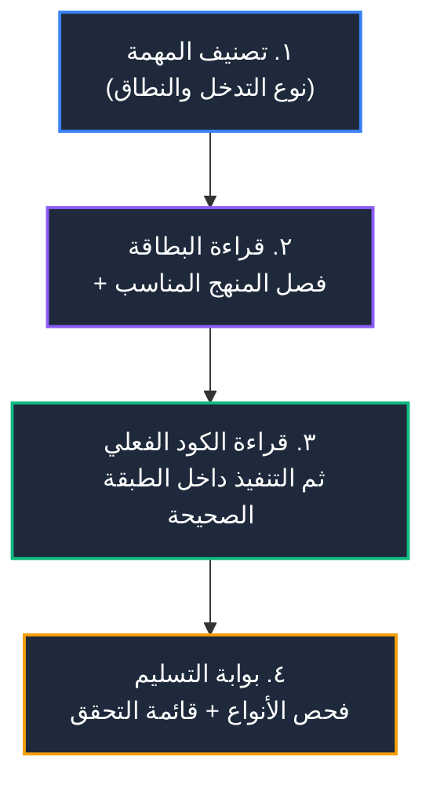

# دليل الواجهة الخلفية — نقطة الدخول (Backend Docs Hub)

> [!IMPORTANT]
> هذه الوثائق مبنية على **ثلاث طبقات**، ولكل طبقة مصدر حقيقة واحد:
>
> | الطبقة | الملف | تحتوي | لا تحتوي |
> | :--- | :--- | :--- | :--- |
> | **١. المنهج (عام)** | [`engineering/UNIFIED_METHODOLOGY.md`](./engineering/UNIFIED_METHODOLOGY.md) | القواعد والطبقات والحدود والأمان والتحقق | أسماء مشاريع، إصدارات، مسارات، بايندنج |
> | **٢. بطاقة المشروع (خاص)** | [`project/PROJECT_PROFILE.md`](./project/PROJECT_PROFILE.md) | الحقائق: الإصدارات، الموارد، الأوامر، نقاط المرجع | قواعد عامة أو نصائح |
> | **٣. أرشيف الجيل السابق** | القسم ٦ أدناه | مرجع تاريخي فقط | أي شيء يُعتمد في كود جديد |
>
> **قاعدة ذهبية:** لا تكتب كوداً قبل قراءة البطاقة، ولا تعتمد على مثال لم تقرأ مصدره في المستودع.
> النموذج الذي يخترع اسم دالة أو بايندنج أو عمود جدول **أخطأ المهمة** حتى لو ترجم الكود.

---

## 1) بروتوكول التنفيذ (٤ خطوات)



**الخطوة ١ — صنِّف:** مسار جديد؟ مخطط تحقق؟ استعلام؟ منطق تجاري؟ مراجعة أمنية؟ توثيق؟ (المنهج §1)

**الخطوة ٢ — اقرأ:** البطاقة كاملة، ثم الفصل المقابل في المنهج، ثم **الملفات الفعلية** التي ستعدّلها. لا تبحث عشوائياً ولا تقرأ المشروع كله.

**الخطوة ٣ — نفّذ:** كل تعديل داخل طبقته، بلا استعلامات في الكنترولر، وبلا منطق تجاري في الوسائط، وبلا أنواع خارج الملف المركزي.

**الخطوة ٤ — تحقّق:** شغّل أمر فحص الأنواع المعتمد في البطاقة (`npx tsc --noEmit` من داخل `backend`) حتى يخرج بالكود `0`، ثم امشِ على قائمة التحقق النهائية (المنهج §9 و§12).

---

## 2) مصفوفة التوجيه (مهمة ← فصل ← مرساة)

| المهمة | اقرأ من المنهج | ثم اقرأ من الكود |
| :--- | :--- | :--- |
| مسار جديد أو تعديل مسار | §1، §2، §3 | `src/routes/auth.routes.ts:58-67` (مسار + مخطط + معالج خطأ) |
| مخطط تحقق جديد | §3 | `src/validators/profile.validators.ts` |
| قراءة مدخلات مفحوصة في كنترولر | §3 | `src/controllers/phones.controller.ts:147` |
| استعلام جديد | §4 | `src/services/accessories.services.ts:53` |
| كتابة متعددة الخطوات | §4 | `src/services/accessories.services.ts:334` |
| تعديل عقد الرد | §5 | `src/utils/response.ts:48` |
| مراجعة أمنية أو ثغرة | §6 | `src/middleware/csrf.ts:68` · `src/middleware/rateLimit.middleware.ts:92` |
| وسيط جديد | §2، §6 | `src/middleware/session.ts:45` · `src/middleware/permission.ts:112` |
| أنواع جديدة | §7 | `src/types.ts:3` |
| توثيق | §8، §11 | البطاقة §9 (قاعدة التحديث) |

> نقاط المرجع في العمود الثالث مأخوذة من ملفات موجودة فعلاً، ومكرَّرة في البطاقة §7 مع أدوارها.

---

## 3) الخطوط الحمراء (غير قابلة للتفاوض)

1. **صفر بيانات وهمية:** لا مستخدم ثابت، لا دور ثابت، لا رمز تحقق ثابت، لا رد مُختلَق. كل قيمة من قاعدة البيانات أو من سياق الطلب.
2. **عزل المستأجر:** كل استعلام يخص مستأجراً يحمل شرط العزل، والمعرّف من الجلسة لا من العميل.
3. **صفر حالة عامة:** لا تخزين بيانات طلب في متغير على مستوى الملف (يُسرَّب بين طلبات الـ isolate).
4. **لا إعادة قراءة جسم الطلب بعد التحقق:** البيانات تُقرأ من مخرَج المخطط فقط؛ إعادة القراءة تتجاوز التطهير والأنواع.
5. **الموارد عبر بايندنج `env`:** لا اتصالات SDK موازية لقاعدة البيانات أو KV أو التخزين؛ SDK للبريد واستدعاءات REST كمسار احتياطي داخل حماية أخطاء.
6. **لا أوامر Git** إلا بطلب صريح حرفياً.
7. **لا بناء أو نشر** إلا بطلب صريح؛ الأمر الوحيد المسموح تلقائياً هو فحص الأنواع.
8. **الأنواع مركزية:** كل نوع/عقد جديد في `src/types.ts`، ولا ملفات أنواع متفرقة.
9. **لا أمثلة كود مؤلَّفة في الوثائق:** كل مثال منسوخ من ملف موجود مع رابط، أو لا وجود له.
10. **لا تخمين:** أي متطلب تجاري ناقص = سؤال مباشر للمستخدم (المنهج §10).

تفصيل كل بند وسببه في [`UNIFIED_METHODOLOGY.md`](./engineering/UNIFIED_METHODOLOGY.md).

---

## 4) أين أجد ماذا؟

| الحاجة | المكان |
| :--- | :--- |
| أسماء الموارد والبايندنج والأوامر والإصدارات | البطاقة §1–§5 — **مصدر الحقيقة** |
| خريطة المجلدات | البطاقة §4 |
| عقد الرد الموحد بالحقول | البطاقة §6 |
| نقاط مرجع الكود (ملف:سطر) | البطاقة §7 |
| الفجوات المعروفة بين المنهج والكود | البطاقة §8 — **اقرأها قبل أن تفترض أن الوضع مثالي** |
| القواعد العامة | `engineering/UNIFIED_METHODOLOGY.md` |

---

## 5) أدلة المشروع الخاصة

| الملف | الحالة |
| :--- | :--- |
| [`project/PROJECT_PROFILE.md`](./project/PROJECT_PROFILE.md) | **معتمد** — يُحدَّث مع أي تغيير في الإعدادات |
| [`TWO_FACTOR_AUTH_PLAN.md`](./TWO_FACTOR_AUTH_PLAN.md) | خطة تاريخية — تحقق من حالة التنفيذ في `src/` قبل الاعتماد عليها |
| [`PROFILE_2FA_SETTINGS_PLAN.md`](./PROFILE_2FA_SETTINGS_PLAN.md) | خطة تاريخية — نفس الملاحظة |

---

## 6) أرشيف الجيل السابق (لا يُعتمد في كود جديد)

الملفات التالية كُتبت قبل فصل «المنهج عن وقائع المشروع»، وتحتوي احتمال تقادم (أمثلة كود غير مطابقة، أسماء تغيّرت، خطط نُفِّذت). تبقى للقراءة التاريخية فقط:

`BACKEND_SYSTEM.md` · `SECURITY_AND_BEST_PRACTICES.md` · `SECURITY_ATTACKS_AND_DEFENSE.md` · `DATABASE_QUERIES_AND_INDEXING.md` · `TYPESCRIPT_CONCEPTS.md` · `libraries/HONO.md` · `libraries/HONO_ZOD_VALIDATOR.md` · `libraries/ZOD.md` · `libraries/SANITIZATION.md` · `libraries/CLOUDFLARE_SDK.md` · `libraries/WRANGLER_AND_VITEST.md`

**قاعدة التعامل مع الأرشيف:** يُقرأ للسياق فقط، ولا يُنسخ منه كود، ولا يُستشهد فيه بسلوك إلا بعد مطابقته بالكود الحالي.

---

## 7) بوابة التسليم

```powershell
cd backend
npx tsc --noEmit
```

لا تُعتبر المهمة منتهية قبل نجاح الفحص، ثم المرور على: العزل، الحدود، غلاف الرد، الأنواع المركزية، وعدم وجود اسم مخترع في الكود أو الوثيقة.
