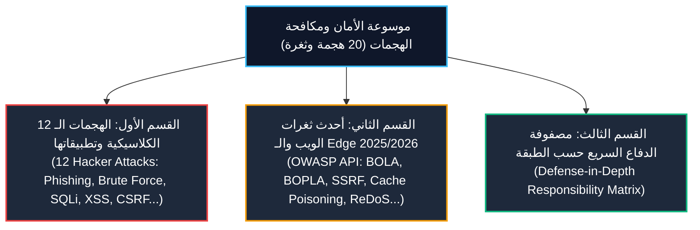

# موسوعة مكافحة هجمات المخترقين وثغرات الويب والـ Edge
# MobiDash Hacker Attacks & Vulnerabilities Defense Encyclopedia

> [!WARNING]
> **أرشيف الجيل السابق — لا يُعتمد في كود جديد.**
> المرجع المعتمد: [`engineering/UNIFIED_METHODOLOGY.md`](./engineering/UNIFIED_METHODOLOGY.md) · [`project/PROJECT_PROFILE.md`](./project/PROJECT_PROFILE.md).
> أسماء الدوال والأمثلة هنا قد لا تطابق الكود الحالي؛ لا تنسخ منها بلا مطابقة.

> [!IMPORTANT]
> **إعلان إلزامي للذكاء الاصطناعي والمهندسين:**
> هذا الدليل هو المرجع الأمني والدفاعي المتقدم لمشروع MobiDash. يُلزم النموذج بمراجعته وتطبيق أكواد الحماية المعتمدة فيه قبل كتابة أو تعديل أي مسارات أو خدمات، لضمان تحصين النظام بالكامل ضد الهجمات السيبرانية الشائعة وأحدث ثغرات الويب لعام 2025/2026 في بيئة Cloudflare Workers و D1.

---

## فهرس محاور الموسوعة الدفاعية (Encyclopedia Sections)



---

# القسم الأول: الهجمات الـ 12 الرئيسية ونماذج الحماية الكودية

---

### 01. التصيد الاحتيالي وإعادة التوجيه المفتوحة (Phishing & Open Redirects)
* **طبيعة الهجوم:** يقوم المهاجم باستغلال نقاط النهاية في الـ Backend لإعادة توجيه المستخدم لصفحة دخول مزيفة (`/api/auth/redirect?url=http://evil.com`) لسرقة بياناته.
* **❌ كود الثغرة الممنوع:**
  ```ts
  app.get('/redirect', (c) => {
    const target = c.req.query('url');
    return c.redirect(target!); // خطأ كارثي: إعادة توجيه مفتوحة لأي نطاق خارجي
  });
  ```
* **✅ كود الحماية المعتمد في MobiDash:**
  ```ts
  app.get('/redirect', (c) => {
    const target = c.req.query('url') || '/';
    // حظر الروابط المطلقة وإلزام المسار النسبي الداخلي فقط
    if (target.startsWith('//') || !target.startsWith('/') || target.includes('://')) {
      return c.redirect(c.env.APP_FRONTEND_URL);
    }
    return c.redirect(`${c.env.APP_FRONTEND_URL}${target}`);
  });
  ```
* **🛡️ الطبقة المسؤولة:** `src/routes/` و `src/validators/`.

---

### 02. حشو الاعتمادات والبيانات المسربة (Credential Stuffing)
* **طبيعة الهجوم:** استهداف واجهة تسجيل الدخول بتجربة ملايين الحسابات وكلمات المرور المسربة عبر روبوتات آلية (Bots).
* **❌ كود الثغرة الممنوع:** فحص الحساب بدون حد لمعدل الطلبات من نفس العنوان أو على نفس البريد.
* **✅ كود الحماية المعتمد في MobiDash:**
  1. تطبيق محدد المعدل في الـ Edge عبر `AUTH_LIMITER` في `src/middleware/rateLimit.middleware.ts`.
  2. تسجيل وتتبع المحاولات الفاشلة لكل مستخدم في ذاكرة KV مع حظر مؤقت تصاعدي (Exponential Backoff):
  ```ts
  const failKey = `auth_fails:${normalizedEmail}`;
  const fails = Number(await c.env.mobidash.get(failKey) || '0');
  if (fails >= 5) {
    return sendResponse(c, 429, 'TOO_MANY_ATTEMPTS', 'تم تجاوز عدد المحاولات، حاول لاحقاً', null);
  }
  ```
* **🛡️ الطبقة المسؤولة:** `src/middleware/` و `src/services/auth.services.ts`.

---

### 03. هجمات التخمين بالقوة الغاشمة (Brute Force)
* **طبيعة الهجوم:** محاولة تخمين أكواد التحقق (OTP المكونة من 6 أرقام) أو كلمات المرور الضعيفة بالتكرار السريع.
* **❌ كود الثغرة الممنوع:** السماح بمحاولات غير محدودة للتحقق من كود الـ OTP.
* **✅ كود الحماية المعتمد في MobiDash:**
  - قصر المحاولات على 5 محاولات كحد أقصى وإبطال الكود تلقائياً فور استنفاد المحاولات:
  ```ts
  const attemptsKey = `otp_attempts:${userId}`;
  const attempts = Number(await env.mobidash.get(attemptsKey) || '0') + 1;
  if (attempts > 5) {
    await env.mobidash.delete(`otp_secret:${userId}`); // إتلاف الرمز فوراً
    return sendResponse(c, 400, 'CODE_EXPIRED', 'انتهت صلاحية الكود بسبب تكرار المحاولات');
  }
  await env.mobidash.put(attemptsKey, String(attempts), { expirationTtl: 900 });
  ```
* **🛡️ الطبقة المسؤولة:** `src/services/` و `src/middleware/rateLimit.middleware.ts`.

---

### 04. حقن استعلامات قواعد البيانات (SQL Injection)
* **طبيعة الهجوم:** إدخال أوامر SQL خبيثة (مثل `' OR '1'='1`) لتسريب الجداول أو حذفها.
* **❌ كود الثغرة الممنوع:**
  ```ts
  // كارثة أمنية: دمج النصوص داخل استعلام D1
  const sql = `SELECT * FROM Users WHERE email = '${email}'`;
  await db.prepare(sql).all();
  ```
* **✅ كود الحماية المعتمد في MobiDash:**
  ```ts
  // إلزامي: الاستعلامات المجهزة المربوطة بالمعاملات حصراً
  const user = await db.prepare(
    'SELECT * FROM Users WHERE email = ? AND dashboard_id = ?'
  ).bind(email, dashboardId).first();
  ```
* **🛡️ الطبقة المسؤولة:** `src/services/`.

---

### 05. البرمجة النصية عبر المواقع (Cross-Site Scripting - XSS)
* **طبيعة الهجوم:** حقن وسوم `<script>` أو أحداث `onload=` داخل حقول الأسماء والملاحظات ليتم تنفيذها في المتصفح أو في رسائل الإيميل.
* **❌ كود الثغرة الممنوع:** حفظ النصوص الخام القادمة من المستخدم دون تعقيم وعرضها مباشرة.
* **✅ كود الحماية المعتمد في MobiDash:**
  1. التحويل التلقائي في Zod: `z.string().trim().transform(sanitizeForDb)`.
  2. استخدام دوال `src/utils/sanitize.ts` قبل التخزين أو توليد قوالب الـ HTML:
  ```ts
  import { sanitizeHtml, sanitizeForDb } from '../utils/sanitize';
  const cleanContent = sanitizeForDb(userInput);
  ```
* **🛡️ الطبقة المسؤولة:** `src/validators/` و `src/utils/sanitize.ts`.

---

### 06. تزوير الطلبات عبر المواقع (Cross-Site Request Forgery - CSRF)
* **طبيعة الهجوم:** استغلال جلسة المتصفح المفتوحة وإرسال طلب خبيث من موقع خارجي لتعديل بيانات أو تحويل أموال.
* **❌ كود الثغرة الممنوع:** قبول طلبات POST/PUT/DELETE معتمدة على الكوكيز دون التحقق من الـ Origin أو الـ SameSite.
* **✅ كود الحماية المعتمد في MobiDash:**
  1. كوكيز الجلسة مضبوطة بـ `SameSite=Lax` و `Secure` و `HttpOnly`.
  2. وسيط فحص `Origin` و `Referer` الصارم في [`../src/middleware/csrf.ts`](../src/middleware/csrf.ts) — يأخذ `source = origin ?? referer` ثم يقارن أصله بقائمة `ALLOWED_ORIGINS`:
  ```ts
  const source = origin ?? referer;
  // ...
  if (!allowedOrigins.includes(sourceOrigin)) {
    return sendResponse(c, 403, 'CSRF_ORIGIN_MISMATCH', 'Cross-Origin Request Blocked', null);
  }
  ```
* **🛡️ الطبقة المسؤولة:** `src/middleware/csrf.ts`.

---

### 07. هجمات رجل في المنتصف والتنصت (Man in the Middle - MitM)
* **طبيعة الهجوم:** اعتراض حركة المرور غير المشفرة بين العميل والخادم وقراءة التوكنات وبيانات الدفع.
* **❌ كود الثغرة الممنوع:** السماح باتصالات HTTP غير المشفرة أو إسقاط ترويسات الأمان.
* **✅ كود الحماية المعتمد في MobiDash:**
  1. إلزام HTTPS عبر طبقة Cloudflare Edge.
  2. حقن ترويسات الأمان مركزياً عبر `secureHeaders()` من `hono/secure-headers` في `src/index.ts` (قبل تركيب أي مسار)، وليس يدوياً داخل كل كنترولر.
* **🛡️ الطبقة المسؤولة:** `src/middleware/` وإعدادات Cloudflare.

---

### 08. سرقة وتثبيت الجلسات (Session Hijacking & Fixation)
* **طبيعة الهجوم:** سرقة توكن الجلسة من التخزين المحلي أو تثبيت توكن محدد للمستخدم لتسجيل الدخول به لاحقاً.
* **❌ كود الثغرة الممنوع:** عدم تغيير توكن الجلسة عند تسجيل الدخول، أو تخزين الجلسات بدون مدة انتهاء صلاحية (TTL).
* **✅ كود الحماية المعتمد في MobiDash:**
  1. توليد معرف جلسة جديد كلياً ومشفّر عشوائياً عند كل تسجيل دخول:
  ```ts
  const sessionToken = crypto.randomUUID();
  await env.mobidash.put(`session:${sessionToken}`, JSON.stringify(sessionData), {
    expirationTtl: rememberMe ? 2592000 : 86400, // 30 يوماً أو 24 ساعة
  });
  ```
  2. توفير آلية الإلغاء الشامل لكافة أجهزة المستخدم فوراً (`revokeAllUserSessions`).
* **🛡️ الطبقة المسؤولة:** `src/services/auth.services.ts` و `src/middleware/session.ts`.

---

### 09. هجمات حجب الخدمة واستنزاف الموارد (DDoS & Resource Exhaustion)
* **طبيعة الهجوم:** إغراق واجهات الـ API بآلاف الطلبات في الثانية لإسقاط الخادم واستنزاف الحصة السحابية.
* **❌ كود الثغرة الممنوع:** فتح نقاط النهاية الحساسة أو الثقيلة بدون تحديد معدل (Rate Limit).
* **✅ كود الحماية المعتمد في MobiDash:**
  - تطبيق محددات المعدل السحابية من `wrangler.jsonc` على مستوى الـ Edge عبر `rateLimitMiddleware`:
    - `AUTH_LIMITER`: 3 طلبات / دقيقة لمسارات الدخول.
    - `LOGIN_RECOVERY_LIMITER`: 5 طلبات / دقيقة.
    - `DASHBOARD_LIMITER`: 100 طلب / دقيقة للمسارات العامة.
* **🛡️ الطبقة المسؤولة:** `backend/wrangler.jsonc` و `src/middleware/rateLimit.middleware.ts`.

---

### 10. الفدية وتدمير البيانات (Ransomware & Data Destruction)
* **طبيعة الهجوم:** استغلال ثغرة لمسح بيانات الجداول بالكامل وابتزاز أصحاب المتاجر.
* **❌ كود الثغرة الممنوع:** تنفيذ أوامر الحذف النهائي المباشر (`DELETE FROM ...`) دون رقابة أو نسخ احتياطي.
* **✅ كود الحماية المعتمد في MobiDash:**
  1. النسخ الاحتياطي التلقائي المدار في Cloudflare D1 (Point-in-Time Recovery).
  2. اعتماد سياسة الحذف المؤقت (Soft Delete) للملفات والكيانات الحساسة:
  ```ts
  await db.prepare('UPDATE Items SET is_deleted = 1, deleted_at = CURRENT_TIMESTAMP WHERE id = ? AND dashboard_id = ?')
    .bind(itemId, dashboardId).run();
  ```
* **🛡️ الطبقة المسؤولة:** `src/services/` وسياسات قواعد البيانات.

---

### 11. هجمات سلاسل التوريد والحزم المسمومة (Supply Chain Attacks)
* **طبيعة الهجوم:** اختراق حزم `node_modules` واستدعاء دوال خبيثة لتسريب مفاتيح الـ API والبيانات.
* **❌ كود الثغرة الممنوع:** استيراد مكتبات عشوائية غير موثوقة لمهام بسيطة يمكن كتابتها بكود نظيف.
* **✅ كود الحماية المعتمد في MobiDash:**
  1. استخدام دوال نقية محلية داخل المشروع (مثل كتابة تعقيم الـ Regex في `src/utils/sanitize.ts` بدلاً من استيراد مكتبات DOM خارجية ثقيلة).
  2. تثبيت الحزم بقفل صارم عبر `package-lock.json` وتفعيل `allowScripts` الانتقائي في `package.json`.
* **🛡️ الطبقة المسؤولة:** `backend/package.json` والهندسة العامة.

---

### 12. ثغرات اليوم الصفر والدفاع المتعدد (Zero-Day & Defense-in-Depth)
* **طبيعة الهجوم:** استغلال ثغرة برمجية غير معروفة للمجتمع في طبقة ما (مثل مكتبة أو نظام تشغيل).
* **❌ كود الثغرة الممنوع:** الاعتماد على فحص طبقة واحدة فقط (مثلاً: التحقق في الفرونت إند فقط أو في المسار فقط).
* **✅ كود الحماية المعتمد في MobiDash:**
  - تطبيق استراتيجية الدفاع في العمق (Defense-in-Depth)؛ بحيث يمر الطلب عبر 5 حواجز دفاعية مستقلة:
    1. Cloudflare WAF & Rate Limiter (الشبكة والـ Edge).
    2. Session & Permission Middleware (الهوية والصلاحية).
    3. Zod Schema Validation (هيئة ونوعية المدخلات وطولها).
    4. Service Authorization & Tenant Filter (`dashboard_id = ?`).
    5. Database Foreign Keys & Constraints (ضمان تكامل البيانات).
* **🛡️ الطبقة المسؤولة:** كافة الطبقات الخمس للواجهة الخلفية.

---

# القسم الثاني: أحدث ثغرات الويب وواجهات برمجة التطبيقات 2025/2026

---

### 13. كسر صلاحيات الوصول على مستوى الكائنات (BOLA / IDOR)
* **طبيعة الهجوم:** تبديل معرّف السجل في المسار (مثل `DELETE /api/invoices/inv-999`)، وإذا كان السيرفر يفحص فقط وجود الـ ID دون فحص ملكية المتجر، يتم حذف بيانات متجر آخر!
* **❌ كود الثغرة الممنوع:**
  ```ts
  await db.prepare('DELETE FROM Invoices WHERE id = ?').bind(id).run();
  ```
* **✅ كود الحماية المعتمد في MobiDash:**
  ```ts
  const res = await db.prepare(
    'DELETE FROM Invoices WHERE id = ? AND dashboard_id = ?'
  ).bind(id, user.dashboard_id).run();
  if (res.meta.changes === 0) {
    return sendResponse(c, 404, 'NOT_FOUND_OR_FORBIDDEN', 'العنصر غير موجود أو لا تملك صلاحية الوصول إليه');
  }
  ```

---

### 14. التعديل غير المصرح به على الخصائص (Mass Assignment / BOPLA)
* **طبيعة الهجوم:** إرسال حقول إضافية غير متوقعة في الـ JSON (مثل `{"role": "owner", "is_banned": false}`) ليتم حفظها مباشرة في قاعدة البيانات.
* **❌ كود الثغرة الممنوع:** تمرير جسم الطلب بالكامل للاستعلام:
  ```ts
  const body = await c.req.json();
  await db.prepare('UPDATE Users SET ...').bind(...Object.values(body));
  ```
* **✅ كود الحماية المعتمد في MobiDash:**
  - استخدام Zod لفلترة الحقول بدقة، وقراءة الحقول المسموحة حصراً عبر `c.req.valid('json')`:
  ```ts
  // المخطط يسمح فقط بتعديل الاسم ورقم الهاتف
  export const updateProfileSchema = z.object({
    name: z.string().trim().min(1).max(100).optional(),
    phone: z.string().trim().max(30).optional(),
  });
  ```

---

### 15. تزوير طلبات جانب الخادم داخل الـ Edge (SSRF in Cloudflare Workers)
* **طبيعة الهجوم:** تمرير رابط خارجي من المستخدم إلى `fetch(userUrl)`، مما يتيح للمهاجم استدعاء شبكات Cloudflare الداخلية أو عناوين الميتا-داتا (`http://169.254.169.254/`).
* **❌ كود الثغرة الممنوع:**
  ```ts
  const targetUrl = c.req.query('avatarUrl');
  const img = await fetch(targetUrl!); // ثغرة SSRF كارثية!
  ```
* **✅ كود الحماية المعتمد في MobiDash:**
  - فحص الرابط بقائمة سماح بروتوكولات صارمة وحظر الـ Private IPs:
  ```ts
  const parsed = new URL(targetUrl);
  if (parsed.protocol !== 'https:') throw new Error('HTTPS_REQUIRED');
  const host = parsed.hostname.toLowerCase();
  if (/^(localhost|127\.|10\.|192\.168\.|172\.(1[6-9]|2[0-9]|3[0-1])\.|169\.254\.)/.test(host)) {
    throw new Error('INTERNAL_NETWORK_FORBIDDEN');
  }
  ```

---

### 16. هجمات تحليل التوقيت (Timing Attacks)
* **طبيعة الهجوم:** قياس الفارق الزمني بالنانو ثانية عند مقارنة التوكنات والـ Hashes لمعرفة الحروف الصحيحة تدريجياً.
* **❌ كود الثغرة الممنوع:** المقارنة المباشرة بالمعامل `===`:
  ```ts
  if (token === expectedSecret) { ... } // ثغرة توقيت!
  ```
* **✅ كود الحماية المعتمد في MobiDash:**
  ```ts
  import { constantTimeEqual } from '../utils/crypto';
  const isValid = await constantTimeEqual(token, expectedSecret);
  ```

---

### 17. تلوث النموذج الأولي للكائنات (Prototype Pollution)
* **طبيعة الهجوم:** إرسال كائنات JSON تحتوي على مفاتيح مثل `__proto__` أو `constructor` للسيطرة على خصائص كائنات النظام وترقية الصلاحيات.
* **❌ كود الثغرة الممنوع:** دمج الكائنات عشوائياً دون فحص المفاتيح.
* **✅ كود الحماية المعتمد في MobiDash:**
  ```ts
  for (const part of permissionParts) {
    if (part === '__proto__' || part === 'constructor' || part === 'prototype') {
      return false; // رفض فوري لمحاولة التلاعب
    }
  }
  ```

---

### 18. خداع وتسميم كاش الـ Edge (Web Cache Deception & Cache Poisoning)
* **طبيعة الهجوم:** استدراج خوادم CDN السحابية لتخزين ردود تحتوي على بيانات مالية أو شخصية وتوزيعها للمستخدمين الآخرين.
* **❌ كود الثغرة الممنوع:** وضع ترويسات `Cache-Control: public` على مسارات الواجهة الخلفية المصادقة.
* **✅ كود الحماية المعتمد في MobiDash:**
  - إرفاق ترويسات منع الكاش التام على كافة استجابات الـ API الحساسة:
  ```ts
  c.header('Cache-Control', 'no-store, no-cache, must-revalidate, private');
  c.header('Pragma', 'no-cache');
  ```

---

### 19. هجمات استنزاف معالج الـ Worker بالتعابير النمطية (ReDoS)
* **طبيعة الهجوم:** إرسال نصوص طويلة مصممة لإجبار محرك الـ Regex على الدخول في تكرار احتمالي كارثي (Catastrophic Backtracking) مما يتسبب في إيقاف الـ Worker السحابي لتجاوز حد الـ CPU المسموح (CPU Quota Crash).
* **❌ كود الثغرة الممنوع:**
  ```ts
  // تعبير نمطي متداخل خطير بدون تقييد للطول
  const emailRegex = /^([a-zA-Z0-9_\.\-])+\@(([a-zA-Z0-9\-])+\.)+([a-zA-Z0-9]{2,4})+$/;
  ```
* **✅ كود الحماية المعتمد في MobiDash:**
  1. تقييد أطوال النصوص إجبارياً بـ `.max(100)` في مخططات Zod لمنع إدخال سلاسل نصية عملاقة.
  2. استخدام تعابير خطية مستقرة أو دوال Zod الجاهزة `z.string().email()`.

---

### 20. حقن المحارف الخاصة في استعلامات البحث (SQL LIKE Wildcard Injection DoS)
* **طبيعة الهجوم:** إرسال نصوص بحث تحتوي على محارف خاصة متكررة (`%` و `_` و `\`) مما يحول استعلام الفهرس السريع إلى Full Table Scan كامل ينهك محرك D1 ويوقف النظام.
* **❌ كود الثغرة الممنوع:**
  ```ts
  // يظن المطور أن الـ bind يحمي من محارف الـ Wildcard!
  await db.prepare('SELECT * FROM Items WHERE name LIKE ?').bind(`%${search}%`).all();
  ```
* **✅ كود الحماية المعتمد في MobiDash:**
  ```ts
  import { escapeLikePattern } from '../utils/sanitize';
  const safeTerm = escapeLikePattern(search); // يحد الطول بـ 100 محرف ويلغي مفعول % و _
  await db.prepare("SELECT * FROM Items WHERE dashboard_id = ? AND name LIKE '%' || ? || '%' ESCAPE '\\'")
    .bind(dashboardId, safeTerm).all();
  ```

---

# القسم الثالث: مصفوفة المسؤولية الدفاعية حسب الطبقات (Defense Matrix)

| الطبقة الهندسية | الثغرات والهجمات التي تتصدى لها هذه الطبقة | الأداة البرمجية المعتمدة |
| :--- | :--- | :--- |
| **`Middleware`** | DDoS, Credential Stuffing, CSRF, Brute Force, MitM, Cache Deception | `rateLimit.middleware`, `csrf.ts`, `session.ts` |
| **`Validators`** | XSS, ReDoS, Mass Assignment (BOPLA), Wildcard Injection, Phishing Redirects | `zod`, `@hono/zod-validator`, `.transform(sanitizeForDb)`, `.max(N)` |
| **`Controllers`** | Stream Re-consumption, Unauthorized Escalation | `c.req.valid('json')`, `sendResponse` بكود أمني مناسب |
| **`Services`** | BOLA / IDOR, SQL Injection, SSRF, Timing Attacks, Prototype Pollution | `constantTimeEqual`, `escapeLikePattern`, `db.prepare().bind()`, `WHERE dashboard_id = ?` |
| **`Database (D1)`** | Ransomware, Data Integrity Loss, Foreign Key Inconsistencies | Foreign Key Constraints, Atomic `db.batch()`, Soft Deletes, Backups |

